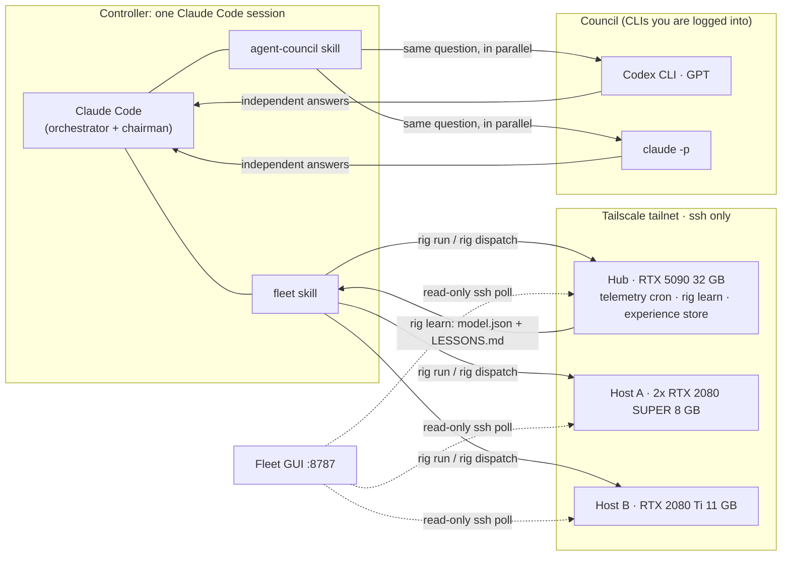

# fleet-council

**One AI brain, many GPUs, several models.** A harness that lets a single Claude Code session drive a heterogeneous
GPU cluster over Tailscale, learn how that cluster actually behaves, and pull other frontier models into a council
when a problem is hard.

- No AnyDesk, no remote desktops, no second Claude session per machine: one agent, one context, every GPU.
- A learned list scheduler that predicts each task on each GPU and gets better after every run.
- A council where Claude and OpenAI's Codex answer independently and Claude chairs the synthesis.



## Why

I had four consumer GPUs of two generations in three machines. The usual options were bad: remote-desktop into each box
and babysit it, or open a separate AI session on every machine and pay for the same context several times over.
Instead, one agent holds the plan and treats the GPUs as tools. It runs jobs, watches them, collects the results, and
writes down what it learned so the next plan is better.

## What is in here

| part | what it does |
|---|---|
| [`fleet/bin/rig`](fleet/bin/rig) | Bash CLI: `run`, `wait`, `collect`, `logs`, `kill`, `gpu`, `exec`, `env-sync` on any host or `all`, in parallel. Jobs run in tmux inside an identical pinned venv, with a 5 s GPU trace. |
| [`fleet/lib/dispatch.py`](fleet/lib/dispatch.py) | Many-task scheduler (stdlib only). One lane per GPU, list scheduling re-planned whenever a lane frees up, live memory caps, OOM-aware cap cuts, retries on another lane, lane retirement, **online calibration** for scripts it has never seen. |
| [`fleet/lib/learn.py`](fleet/lib/learn.py) | Fits per-lane `time = a + b·size`, push rates, GPU throughput, memory per unit, reliability and hourly free-memory profiles from every run → `model.json` + `EXPERIENCE.md`. |
| [`fleet/lib/sample.py`](fleet/lib/sample.py) | Cron telemetry: every GPU on every host each minute (util, memory, temp, power, clocks, who holds it; other users anonymized) + hourly bandwidth probes. |
| [`fleet/experience/LESSONS.md`](fleet/experience/LESSONS.md) | The curated half of the memory: lessons the agent writes after each run, with evidence and confidence. |
| [`gui/`](gui/) | Stdlib web dashboard: live GPUs, jobs, processes and log tails for the whole fleet, read-only. |
| [`skills/fleet`](skills/fleet/SKILL.md) | The Claude Code skill that teaches the agent the protocol: read experience → plan → run → learn. |
| [`skills/agent-council`](skills/agent-council/) | My council setup on top of the open-source agent-council skill. |

## Measured on the reference fleet

1x RTX 5090 (shared desktop, Blackwell) + 2x RTX 2080 SUPER + 1x RTX 2080 Ti (Turing), one tailnet, 1 GbE uplink on the hub.

- **1.5 billion-point city LiDAR cloud**: ground extraction across all 4 GPUs in about 10 minutes.
- **2.2x** over the 5090 alone on compute-heavy tiles with compact inputs; **1.5x** on I/O-bound point clouds, where the
  hub's single 1 GbE uplink is the bottleneck. The learned model tells the agent which case it is in before it starts.
- **Prediction error 40% → 7%** on one lane after replacing a shared-uplink assumption with each lane's own learned push rate.
- **×117 misprediction neutralized**: a never-seen render script was predicted at 1.3 s per 150 s chunk; online
  calibration rescaled it within the run and all four lanes finished within 90 s of each other.
- **1.75x render throughput** from two lanes on one 5090 after telemetry showed Blender frames were ~90% CPU scene sync.
- **Byte-identical outputs** on Turing and Blackwell for the same tile, so any task can go to any lane.

These come from the fleet's own logs (`rig learn`), written up in [LESSONS.md](fleet/experience/LESSONS.md).

## Quick start

```bash
git clone https://github.com/<you>/fleet-council && cd fleet-council
./install.sh hub                       # or: ./install.sh controller  (on the laptop)
$EDITOR ~/fleet/hosts.conf             # name  ssh-alias  gpu-indices
rig setup all && rig env-sync all && rig wait all envsync && rig hosts
rig run all smoke -d ~/fleet/jobs/smoke -- python train.py --epochs 3 && rig wait all smoke && rig collect all smoke
```

Full walkthrough (Tailscale, ssh keys, cron, scheduler demo, dashboard, skills): **[docs/SETUP.md](docs/SETUP.md)**.

## Design choices

- **ssh + tmux + rsync, not a framework.** Nothing to install on a host but a venv. A job survives the laptop sleeping.
- **Independent jobs per GPU, not cross-machine DDP.** Mixed generations over a tailnet would throttle the fast card.
- **Two kinds of memory.** Numbers (`model.json`, rebuilt nightly) and judgment (`LESSONS.md`, written by the agent,
  wrong lessons retired, not deleted). The agent reads both before it plans.
- **Shared GPUs are respected.** Caps come from live free memory minus a reserve; other users' processes are counted, never touched.
- **The dashboard can't run commands.** It only tails log files that each host's collector lists.

## Credits

The council scripts are [team-attention/agent-council](https://github.com/team-attention/agent-council), inspired by
[karpathy/llm-council](https://github.com/karpathy/llm-council). Everything under `fleet/`, `gui/` and `skills/fleet/`
is original to this repo (MIT).
