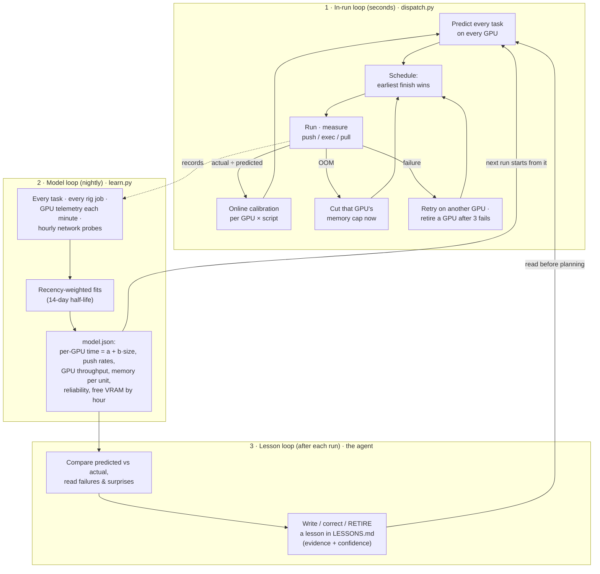

# How the fleet adapts

The fleet is not configured with how fast each GPU is, how much memory a job needs, or how good the network is.
It finds out by running work, and it changes its behavior from what it sees. That happens in three loops that run
at three timescales.

## 1. In-run loop: adapt within seconds (`fleet/lib/dispatch.py`)

| signal | reaction |
|---|---|
| A GPU frees up | Re-plan the whole remaining queue (simulated list scheduling, longest task first, earliest finish wins). A GPU may deliberately **wait** if the plan says another GPU will finish that task sooner. |
| Live free VRAM at start | Each GPU gets a size cap = (free memory − 900 MB reserve) ÷ learned memory per unit. Shared GPUs are planned for what is actually free, not their spec sheet. |
| Out-of-memory | That GPU's cap drops to 80% of the task that failed, **immediately**, for the rest of the run. |
| Any failure | The task goes back in the queue, barred from the GPU it failed on; 3 attempts. A GPU that fails 3 tasks in a row retires itself mid-run. |
| Actual vs predicted time | Each GPU's predictions are rescaled by the **median actual/predicted ratio** seen so far in this run, for this script. GPUs with no finished task yet borrow the run-wide median. |
| Unreachable host | Dropped from the plan at probe time; the rest of the fleet carries the queue. |

**Real example.** A render script had never run on the fleet. The physics fallback predicted 1.3 s for a chunk that
really took 150 s, a factor of 117. Without calibration the scheduler would have starved the remote GPUs near the end
of the queue. With it, the ratio was learned from the first finished chunks, and **all four GPUs finished within 90 s
of each other**.

## 2. Model loop: adapt overnight (`fleet/lib/learn.py`, cron)

Everything is recorded automatically: every dispatched task (predicted vs actual, push/exec/pull split, GPU memory,
error class), every `rig run` job (exit code, error class, a 5-second GPU trace), every GPU every minute (utilization,
memory, temperature, power, clocks, and *who* holds it, with other users anonymized), and hourly bandwidth probes.

`rig learn` (nightly) turns that into `model.json`:

- **Per-GPU duration fits** `time = a + b·size` by weighted least squares, with a **14-day half-life**, so a driver
  update, a new network path or a degrading card shows up in the model within days.
- **Prior-slope fallback.** If a GPU only ever saw similar-sized tasks (size spread < 2×), the slope can't be learned,
  so it uses the GPU's measured pure compute rate as the slope and fits only the fixed cost.
- **Per-GPU push rates** and the **shared uplink rate × typical concurrency**, so transfer time is predicted for the
  link as it is actually shared, not as one big pipe.
- **GPU throughput** per card and script, **p95 memory per unit** (which sets the next run's caps), **reliability**
  and **error classes** per GPU (oom, killed, module, missing file, ssh, nccl, ...).
- **Free VRAM by hour of day** per GPU, learned from telemetry: when a shared GPU is usually busy and when it frees up.

**Real example.** The first model assumed the hub's uplink is split evenly among the remote GPUs. One GPU was
over-predicted by 40%: small tasks finished their uploads early, so the GPU with big tasks got most of the link.
Learning each GPU's own observed push rate brought its error to **7%**.

**Real example.** The scheduler kept handing the same GPU the same task size, so its time-vs-size slope came out as 0.
That is how the prior-slope fallback was added: a deterministic scheduler can starve its own learner.

## 3. Lesson loop: adapt the agent's judgment (`fleet/experience/LESSONS.md`)

Numbers don't capture everything. After each run, the agent (Claude Code, following `skills/fleet/SKILL.md`) runs
`rig learn`, compares predicted vs actual, and edits `LESSONS.md`:

- A surprise, a new failure class or a systematic error becomes a **dated lesson** with evidence and a confidence
  (HIGH = measured repeatedly, MED = a few times, LOW = inferred).
- A lesson the data contradicts is **corrected or marked RETIRED**, never silently deleted, so the history of what
  the fleet believed stays visible.
- Before planning any GPU work, the agent reads `rig experience`: the lessons, the learned model and live GPU state.

**Real example.** Telemetry showed a large Blender scene spending ~10 of 11 s per frame in CPU scene sync, not on the
GPU. That led to trying two lanes sharing one GPU (`--extra-lanes`), which measured **1.75× throughput**, and became
the lesson "big Blender scenes are CPU-bound: put two render lanes on the 5090".

**Real example.** Two renders at once on a 16 GB-RAM host drove free RAM to 0.6 GB and GPU utilization to ~0%. The
lesson "this host cannot run two RAM-heavy renders" means the agent now gives it a single lane for that kind of job.

## What this adds up to

The first run of a new job on a new GPU is planned from physics and corrected live. Every later run is planned from
that GPU's own history, weighted toward the recent past, with the agent's written judgment on top. Adding a GPU needs
no tuning: it gets a lane, gets calibrated in its first run, and gets its own fitted model the next night.
