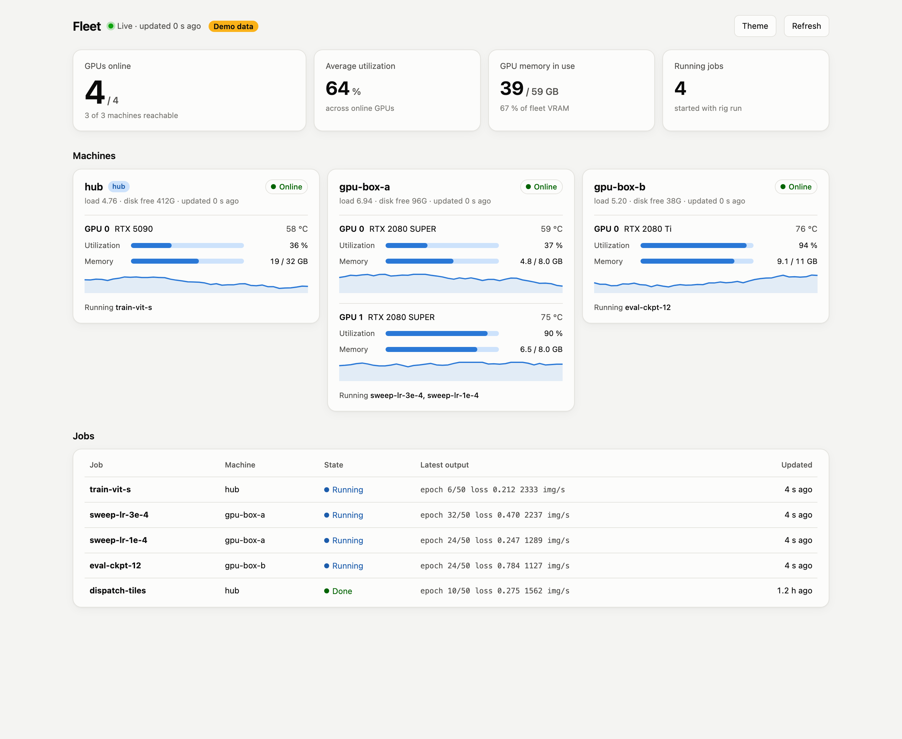

# Fleet GUI

A read-only web dashboard for every GPU in the fleet: live utilization, memory and temperature per card, a short
utilization history, the jobs started with `rig run`, and the processes and log tails of any machine you click.
It runs on the controller (your laptop), polls the machines over ssh, and needs nothing but Python 3.9+.

| Dark | Light |
|---|---|
|  |  |

## Try it in 10 seconds

No cluster needed: `--demo` serves a simulated three-machine fleet, badged "Demo data" on the page.

```bash
git clone https://github.com/odeij/fleet-council && cd fleet-council
python3 gui/server.py --demo          # then open http://127.0.0.1:8787
```

## Use it on your fleet

Prerequisites: the fleet is set up (`rig setup all` pushes the collector to every machine; see
[docs/SETUP.md](../docs/SETUP.md)), and the laptop can `ssh <hub-alias>` without a password.

```bash
FLEET_HUB=<hub ssh alias> bash gui/run.sh     # start in the background and open the browser
bash gui/run.sh demo                          # same, with the simulated fleet
bash gui/run.sh log                           # server log
bash gui/run.sh stop
```

Or in the foreground, with every option on the command line:

```bash
cd gui && python3 -m fleet_gui --hub <hub ssh alias> --port 8787 --interval 20
```

| Option | Environment | Default | Meaning |
|---|---|---|---|
| `--hub` | `FLEET_HUB` | `hub` | ssh alias of the hub that holds `~/fleet/hosts.conf` |
| `--collect` | `FLEET_COLLECT` | `python3 rig-runs/.bin/collect.py --json` | command run on each machine |
| `--port` | `FLEET_GUI_PORT` (run.sh) | `8787` | port on 127.0.0.1 |
| `--interval` | `FLEET_GUI_INTERVAL` (run.sh) | `20` | seconds between polls |
| `--demo` | | off | simulated fleet, no ssh |

Page options: `?theme=light` or `?theme=dark` forces a theme; the Theme button remembers your choice.

## How it works

```
 browser ──5 s──▶ fleet_gui (laptop, 127.0.0.1) ──every 20 s, in parallel, ssh──▶ each machine
                    │  hub:~/fleet/hosts.conf → which machines exist          runs collect.py --json
                    │  latest snapshot + 40 samples of history per GPU        (GPUs, jobs, processes, logs)
                    └─ static page + JSON API
```

- **Machines come from the hub's `hosts.conf`**, re-read on every poll, so a machine added to the fleet appears by
  itself. One that does not answer is shown offline with its last known state.
- **Each machine reports itself** through [`fleet/agent/collect.py`](../fleet/agent/collect.py): `nvidia-smi`, `ps`
  and the `~/rig-runs/<job>` directories. Nothing is installed on the machines beyond what `rig setup` already pushes.
- **Read-only by design.** The server never runs an arbitrary command on a machine. The only remote calls are the
  collector and `tail` of a log path that the machine's own collector listed. It listens on 127.0.0.1 only, and ssh
  aliases that look like ssh options are ignored.

## API

| Route | Returns |
|---|---|
| `GET /api/state` | every machine's latest snapshot, online status, GPU history, poll time |
| `GET /api/log?rig=NAME&path=PATH&n=80` | the last `n` lines (10 to 400) of a log the collector listed |
| `POST /api/refresh` | starts the next poll now (202) |

## Code layout

```
gui/
├── server.py              launcher: python3 gui/server.py [options]
├── run.sh                 background start / stop / log helper
├── fleet_gui/
│   ├── __main__.py        command line, wiring
│   ├── state.py           thread-safe store: snapshots and GPU history
│   ├── sources.py         SshFleet (real machines) and DemoFleet (simulated)
│   ├── poller.py          parallel polling on an interval
│   ├── web.py             HTTP routes
│   └── static/            index.html, styles.css, app.js, theme.js (no build step)
└── tests/test_fleet_gui.py
```

Run the tests from the repo root:

```bash
python3 -m unittest discover -s gui/tests
```

To show your own data source, implement the three methods of `sources.Source` (`discover`, `poll`, `tail`) and pass
it to the poller in `__main__.py`; `DemoFleet` is a complete example.
